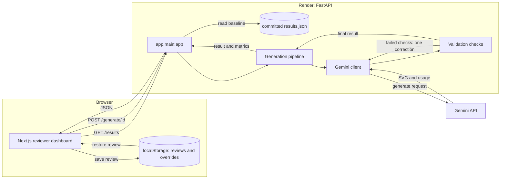
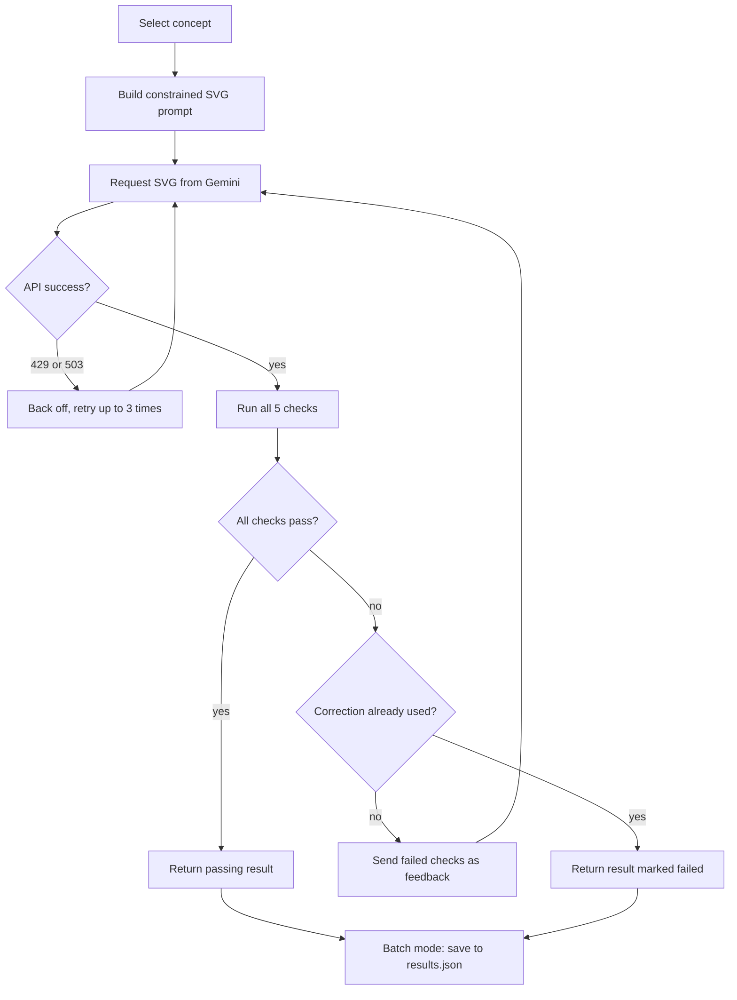

# Science Diagram Maker

An AI-powered diagram generation and quality review tool for UK GCSE science and mathematics. Built for the Udhi Technologies home assignment using **Next.js, FastAPI and Google Gemini**.

The application generates animated SVG illustrations, validates them programmatically, retries recoverable failures, records token usage and estimated cost, and allows human reviewers to approve or reject diagrams with notes.

> **Live demo:** [frontend-mu-five-37.vercel.app](https://frontend-mu-five-37.vercel.app/)  
> **Backend API:** [udhi-diagrams.onrender.com](https://udhi-diagrams.onrender.com)  
> **API documentation:** [Swagger UI](https://udhi-diagrams.onrender.com/docs)

## Quick start

Requires [Git](https://git-scm.com/), [uv](https://docs.astral.sh/uv/) and [Bun](https://bun.sh/). Run the backend and frontend in two terminals from the repository root.

```bash
# Terminal 1 - API
cd backend
uv sync --locked
uv run fastapi dev src/app/main.py
```

```bash
# Terminal 2 - dashboard
cd frontend
bun install --frozen-lockfile
bun run dev
```

Open [http://localhost:3000](http://localhost:3000). The five saved diagrams load without an API key; see [Local development](#local-development) for environment files and live generation.

## Features

- Five pre-generated, animated diagrams loaded from `results.json` without a Gemini API request.
- On-demand generation of an individual concept using Gemini 3.5 Flash-Lite.
- Five automated checks covering SVG parsing, viewBox boundaries, title and labels, animation, and safety.
- One correction attempt when validation fails, with specific failure feedback included in the next prompt.
- Exponential backoff for HTTP `429` and `503`, with at most three API retries per generation attempt.
- Per-concept token usage, estimated USD cost, retry counts and validation results.
- Reviewer approval, rejection and notes, persisted in the browser and associated with the generated SVG version.
- Isolated SVG image previews, loading states and user-facing API error messages.

## Generation results

The following results are from the recorded five-concept batch generation run, using `gemini-3.5-flash-lite`. They include usage from the initial generation and any successful correction response. All five saved SVGs also passed revalidation after XML parser and numeric geometry hardening.

| Concept | Subject | Result | Input tokens | Output tokens | Est. cost (USD) | API retries | Validation retries | Total retries |
| --- | --- | --- | ---: | ---: | ---: | ---: | ---: | ---: |
| Pythagoras' theorem | Maths | PASS (5/5) | 499 | 2,676 | $0.006840 | 0 | 0 | 0 |
| Parts of a circle | Maths | PASS (5/5) | 1,040 | 3,301 | $0.008565 | 2 | 1 | 3 |
| Series circuit | Physics | PASS (5/5) | 483 | 2,192 | $0.005625 | 0 | 0 | 0 |
| Photosynthesis | Biology | PASS (5/5) | 475 | 2,138 | $0.005488 | 0 | 0 | 0 |
| States of matter | Chemistry | PASS (5/5) | 489 | 3,742 | $0.009502 | 3 | 0 | 3 |
| **Total** | | **25/25 checks** | **2,986** | **14,049** | **$0.036018** | **5** | **1** | **6** |

Costs are rounded for display; the total is calculated from unrounded values. These are the saved batch results, not the totals of all exploratory requests or subsequent live generations. A programmatic PASS does not imply human approval or guarantee scientific accuracy.

### Cost calculation

The application estimates the paid-equivalent cost from Gemini usage metadata:

```text
estimated_cost_usd = (input_tokens × input_rate + output_tokens × output_rate) / 1,000,000
```

The configured rates for Gemini 3.5 Flash-Lite are $0.30 per million input tokens and $2.50 per million output tokens. Billable output includes thinking tokens where reported by the SDK. Missing usage or pricing information is represented as unknown rather than zero.

The assignment uses the free Gemini tier. Estimated cost is a comparison metric, not a claim of actual charges. See [Gemini API pricing](https://ai.google.dev/gemini-api/docs/pricing) for the applicable rates and tier limits.

## Technology stack

| Layer | Technology |
| --- | --- |
| Frontend | Next.js (App Router), React, TypeScript |
| UI | Tailwind CSS, shadcn/ui, Lucide, Sonner |
| Frontend tooling | Bun |
| Backend | Python, FastAPI, Pydantic |
| Backend tooling | uv, Ruff, pytest |
| AI provider | Google Gen AI SDK, Gemini 3.5 Flash-Lite |
| SVG processing | defusedxml, custom geometry and SMIL checks |
| Storage | JSON baseline dataset and browser localStorage |

## Architecture

The project is a monorepo containing two independently runnable applications. The backend owns AI generation and validation; the frontend owns the review experience. The Gemini API key never needs to reach the browser.



### Generation lifecycle

1. Retrieve the selected concept and build a prompt from its original assignment description.
2. Request one animated SVG from Gemini, using a constrained SVG subset and SMIL animation.
3. Run all five checks against the returned document.
4. If any check fails, send the failure messages to Gemini for one corrected generation.
5. Return the final SVG, check outcomes and cumulative usage and retry counts. A result that still fails validation is marked as failed, not silently accepted.
6. For batch generation, save each completed result immediately to `results.json` so an interruption does not discard earlier work.

API retries and validation retries are independent. Each generation attempt can make one initial API request and up to three retries on `429` or `503`, waiting 5, 10 and 20 seconds respectively. A concept can receive at most one validation-triggered correction within a pipeline run.



### Validation checks

| Key | What is checked |
| --- | --- |
| `valid_svg` | Well-formed XML, correct SVG root namespace, safe parsing and size limit. |
| `within_viewbox` | Numeric viewBox and supported shape geometry; static shape bounds and selected animation coordinates are checked against the viewBox. |
| `title_and_labels` | Non-empty title and at least three non-empty SVG text elements. |
| `has_animation` | Repeating SMIL animation with required attributes and values or a supported range. |
| `safe_svg` | Custom check: reject unsupported elements, scripts, event handlers, external references, inline styles and transformations. |

The generator is prompted to use simple shapes, numeric coordinates and SMIL instead of arbitrary SVG paths, CSS or transforms. This reduces validation complexity and makes failed checks easier to explain to the model.

The validator is intentionally scoped to this subset. It is not a general-purpose SVG renderer or sanitizer. See [Known limitations](#known-limitations) for the checks that remain approximate.

## Project structure

```text
udhi-diagrams/
├── backend/
│   ├── src/app/
│   │   ├── main.py              # FastAPI endpoints and CORS
│   │   ├── config.py            # Environment, pricing and retry settings
│   │   ├── concepts.py          # Five assignment concepts
│   │   ├── schemas.py           # Pydantic data models
│   │   ├── gemini_client.py     # Prompt, API calls, backoff and usage
│   │   ├── checks.py            # SVG validation and correction feedback
│   │   ├── pipeline.py          # Generation and validation orchestration
│   │   └── store.py             # JSON result storage
│   ├── scripts/
│   │   ├── generate_all.py      # Resumable batch generation
│   │   └── test_generation.py   # Local generation smoke test
│   ├── tests/
│   │   ├── test_api.py
│   │   ├── test_checks.py
│   │   └── test_pipeline.py
│   ├── results.json            # Five committed baseline results
│   ├── .env.example
│   ├── pyproject.toml
│   └── uv.lock
├── frontend/
│   ├── src/
│   │   ├── app/                # App Router entry point and layout
│   │   ├── components/         # Dashboard, table, previews and review UI
│   │   ├── hooks/              # Persistent reviewer state
│   │   ├── lib/                # API client and browser storage
│   │   └── types/              # TypeScript API contracts
│   ├── .env.example
│   ├── package.json
│   └── bun.lock
└── README.md
```

## Local development

### Prerequisites

- [Git](https://git-scm.com/)
- [uv](https://docs.astral.sh/uv/) (uses the Python version pinned by the backend; development logs used Python 3.14.7)
- [Bun](https://bun.sh/)
- A Gemini API key from [Google AI Studio](https://aistudio.google.com/api-keys) for live generation only

Clone this repository and run the following commands from its root. Backend and frontend run in separate terminals.

### 1. Start the backend

```bash
cd backend
uv sync --locked
```

Copy `.env.example` to `.env` and configure:

```dotenv
GEMINI_API_KEY=
GEMINI_MODEL=gemini-3.5-flash-lite
FRONTEND_URL=http://localhost:3000
```

Insert your own API key locally. Leave it empty if you only want to browse the five pre-generated diagrams.

```bash
uv run fastapi dev src/app/main.py
```

The API is available at `http://localhost:8000`, with interactive documentation at [http://localhost:8000/docs](http://localhost:8000/docs).

### 2. Start the frontend

In a second terminal, from the repository root:

```bash
cd frontend
bun install --frozen-lockfile
```

Create `.env.local` using `.env.example`:

```dotenv
NEXT_PUBLIC_API_URL=http://localhost:8000
```

```bash
bun run dev
```

Open [http://localhost:3000](http://localhost:3000). The dashboard requests the saved results from FastAPI; this does not call Gemini.

### 3. Generate or regenerate the baseline dataset (optional)

The committed `backend/results.json` should already contain all five diagrams. No generation command is required to start the application.

If you need to regenerate missing or failed results, run from `backend/`:

```bash
uv run python -m scripts.generate_all
```

Previously passed concepts are skipped by default. To deliberately replace all five results:

```bash
uv run python -m scripts.generate_all --force
```

This command uses the Gemini API and may consume the free-tier quota. Successful results are saved incrementally. The command returns a nonzero exit code if not all five concepts have a passing saved result.

Revalidate existing SVGs locally without making AI requests:

```bash
uv run python -c "from app.store import load_results; from app.checks import run_checks; [print(r.concept_id, {k: v.passed for k, v in run_checks(r.svg).items()}) for r in load_results()]"
```

## API reference

| Method | Endpoint | Description |
| --- | --- | --- |
| GET | `/health` | Backend availability check. |
| GET | `/results` | Saved diagram results with concept metadata. No AI request. |
| POST | `/generate/{concept_id}` | Generate and validate one concept (IDs 1–5). |

Example requests (replace `curl` with `curl.exe` in Windows PowerShell if necessary):

```bash
curl http://localhost:8000/health
curl http://localhost:8000/results
curl -X POST http://localhost:8000/generate/2
```

A diagram response contains `concept` and `result`. The result includes the SVG, model, individual check messages, input/output tokens, estimated cost, API retries, validation retries, total retries and overall validation status.

| HTTP status | Meaning |
| --- | --- |
| `200` | Request completed. Check `result.passed` for the validation outcome. |
| `404` | Concept ID not found. |
| `429` | Gemini rate limit persisted after retries. |
| `503` | Gemini remained unavailable after retries. |
| `502` | Other handled generation/API failure. |
| `500` | Unexpected backend error. |

API errors are distinct from validation failures: a completed generation with failed checks remains a reviewable result, while an API exception is surfaced as an error response.

## Storage and review decisions

**Storage choice: JSON for the baseline and localStorage for reviewer data.**

The original five diagrams live in the committed `backend/results.json`. The batch script writes results incrementally using a temporary file replacement. The live generation endpoint returns a new result without mutating the shared baseline.

The frontend uses browser `localStorage` for approve/reject decisions, notes and locally regenerated diagram overrides. Reviews are associated with a lightweight SVG content version identifier, so a changed diagram does not inherit an approval for its previous content. Restoring the original diagrams removes local generation overrides.

This is appropriate for a small, single-reviewer demonstration: no database, account system or persistent hosting disk is required, and one reviewer cannot overwrite the baseline for other visitors. Data is specific to the browser and origin; it does not synchronize across devices and can be removed by clearing site data. The version identifier is not a cryptographic security mechanism.

## Testing

Run the backend test suite from `backend/`:

```bash
uv run pytest -v
uv run ruff check .
```

**Last verified backend run:** 40 tests passed in 0.62 seconds.

| Area | Passed tests |
| --- | ---: |
| SVG checks and security regressions | 26 |
| Gemini client (cost, models, usage) | 6 |
| Generation pipeline | 2 |
| REST API | 6 |
| **Total** | **40** |

Tests cover malformed XML, wrong namespace, static and animated coordinate overflow, missing labels/title, missing or non-repeating animations, unsafe SVG content, non-finite geometry, XML entities, usage aggregation, correction feedback and REST responses including simulated rate limits and service unavailability. Mocked generation tests do not consume Gemini quota.

A real five-concept batch run and a live generation request for States of matter were also verified. The frontend connectivity smoke test confirmed that all five saved results were fetched successfully.

### Frontend production checks

Run from `frontend/`:

```bash
bunx tsc --noEmit && bunx eslint . && bun run build
```

The deployed frontend is on Vercel and the API on Render; `/health`, `/results` and `/docs` were checked against the live backend. Review interactions are verified manually in the browser — they are not covered by the automated suite.

## What failed and how it was fixed

### 1. Gemini returned an unsupported SVG transformation

The first batch response for Parts of a circle contained a `transform` attribute. While transformations are legitimate SVG, this implementation deliberately excludes them because the geometry checker does not resolve transformed coordinates.

The safety check rejected the output. The pipeline sent the failed check message to Gemini and requested a corrected document once. The corrected response passed all five checks, without manual SVG modification. Two transient API failures also occurred during that correction request and were recovered by the retry loop.

An earlier Pythagoras smoke test also exposed a rectangle extending from `y=380` to `y=530` outside the requested 500-unit-high viewBox, demonstrating why geometry checks are necessary even when XML parsing succeeds.

### 2. Transient Gemini service failures

During the States of matter batch generation, the first three API requests returned HTTP `503`. The client waited 5, 10 and 20 seconds before subsequent attempts. The fourth request succeeded and all five validation checks passed. The final result recorded three API retries.

Final production testing also saw intermittent `503` and `504` responses from both the primary and fallback Gemini models. `503` uses the backoff loop; `504` falls through to the next configured model, and a clear API error is returned if none succeeds. The five saved diagrams stay accessible because live generation never mutates the committed baseline.

### 3. Validator and schema integration bugs

During development, the viewBox loop attempted to unpack three values from a four-field interval tuple. Correcting the tuple contract fixed the geometry-related test failures.

The pipeline also exposed mismatched Pydantic field names (`check` versus `checks`, and `import_tokens` versus `input_tokens`). Standardizing the schema resolved those errors. The regression suite subsequently passed, and the parser was hardened against unsafe XML constructs and non-finite numeric values.

## Deployment

The application is deployed on **Render for FastAPI** and **Vercel for Next.js**. Both services are built independently from the same repository using the settings below.

| Service | Public URL |
| --- | --- |
| Frontend | [Live reviewer dashboard](https://frontend-mu-five-37.vercel.app/) |
| Backend | [Render API](https://udhi-diagrams.onrender.com) |
| API documentation | [Swagger UI](https://udhi-diagrams.onrender.com/docs) |
| Health check | [/health](https://udhi-diagrams.onrender.com/health) |

### Backend (Render)

Create a Python web service using the repository and set the root directory to `backend`.

| Setting | Value |
| --- | --- |
| Build command | `python -m pip install --upgrade pip uv && uv sync --frozen --no-dev` |
| Start command | `uv run uvicorn app.main:app --host 0.0.0.0 --port $PORT` |
| Health check path | `/health` |

Set these environment variables in the service settings (not in Git):

```dotenv
GEMINI_API_KEY=<your private API key>
GEMINI_MODEL=gemini-3.5-flash-lite
FRONTEND_URL=https://frontend-mu-five-37.vercel.app
```

Ensure the build uses the Python version supported by the pinned project configuration, and that `results.json` is committed. Verify `/health`, `/results` and `/docs` using the deployed backend URL. Free hosting can introduce cold starts; live generation also needs sufficient request time for model latency and backoff.

### Frontend (Vercel)

Import the same repository, set the root directory to `frontend`, and use the Next.js framework preset. Install with `bun install --frozen-lockfile` and build with `bun run build`.

Set:

```dotenv
NEXT_PUBLIC_API_URL=https://udhi-diagrams.onrender.com
```

Set the backend's `FRONTEND_URL` to the exact deployed frontend origin (scheme and hostname, without a trailing slash) to allow CORS. Rebuild the frontend if its public API URL changes.

### Deployment verification

Load the deployed frontend in a private window and check that all five baseline diagrams render, reviews survive a refresh, and one live generation works. Confirm that no `.env` or API key is tracked in Git.

## Security and operational considerations

- Gemini credentials are read from backend environment variables; only the API base URL is public on the frontend.
- Untrusted XML is parsed with `defusedxml`, with DTDs, entities and external references forbidden. Input size is limited.
- Generated SVGs should be displayed in an isolated HTML image context rather than injected as HTML. Previews are suppressed if parsing or safety validation fails.
- The API accepts a fixed set of concept IDs rather than arbitrary prompt text. CORS restricts browser origins but is not authentication or rate limiting.
- The demo does not implement server-side authentication or shared review storage. Public live generation can consume the available model quota; do not expose a paid unrestricted key.

## Known limitations

- **Geometry:** the current viewBox check handles supported primitive shape bounds and selected animated coordinates. It does not fully account for stroke extents, rendered text width, every animated shape extent or unsupported SVG geometry. For example, a moving circle's centre can be inside the viewBox while its radius crosses the boundary.
- **Animation and safety:** checks target a constrained SMIL subset. A complete animation-attribute allowlist, stricter duration/value validation and broader adversarial cases would make this more robust. The safety check is not a substitute for rendering isolation.
- **Educational correctness:** automated checks are structural and geometric; they do not prove scientific correctness, label readability, non-overlap or meaningful motion. This is deliberate — the human review step exists to catch what structural checks cannot.
- **Cost accounting:** reported costs are based on returned usage metadata for the displayed result. They are not a billing ledger, and usage on unsuccessful API responses may be unavailable. Partial usage when a correction request ultimately fails is not represented in a completed result.
- **Reliability:** synchronous requests and free-tier service limits can increase live generation latency. The browser generation lock prevents duplicate clicks in one session, not requests from multiple users.

## What I would do with one more day

1. Harden geometry validation for animated radii, stroke widths and text bounds, and add adversarial SVG cases.
2. Add retry-exhaustion and timeout tests plus Playwright coverage for review persistence, regeneration and API failures.
3. Add request throttling and structured logs, then run a dedicated GCSE accuracy review before exposing live generation more widely.

## AI tools used

| Tool | Use |
| --- | --- |
| Google Gemini 3.5 Flash-Lite | Runtime generation of animated SVG diagrams and corrections based on failed validation checks. |
| ChatGPT (OpenAI) | Architecture discussions, implementation examples, validator and retry design, debugging, frontend integration guidance and README drafting. |
| OpenCode | Terminal coding agent for repository exploration, backend debugging, deployment commands and README edits. |
| Google Antigravity | Agentic IDE used for code generation, refactoring and local verification alongside the other tools. |

AI-generated implementation suggestions and documentation were used as development aids; the assignment was developed iteratively, with local execution and test results used to verify the behaviour. Diagram generation metrics in this README come from actual recorded Gemini responses, not mock data.

---

Built for the **Udhi Technologies — Science Diagram Maker** home assignment.
